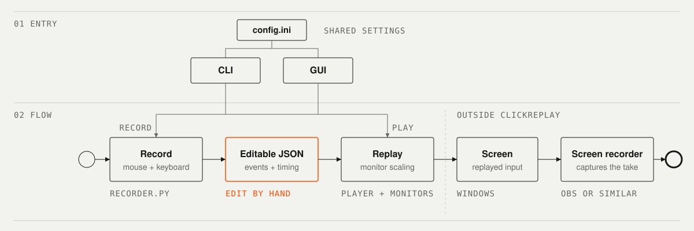

# ClickReplay

Record mouse and keyboard actions to editable JSON, then replay them for repeatable screen demos.

**ClickReplay does not record video.** Use a screen recorder such as OBS alongside it.

[](#install)
[](https://www.python.org/downloads/)
[](LICENSE)

Version 0.1.1, beta. Windows only, Python 3.12+.

## Why it exists

I built ClickReplay at Microsoft for a six-part tutorial video series on manufacturing in Business Central ([the series](https://www.youtube.com/playlist?list=PLEyIZHETM3k4)).
Each demo needed clean, repeatable takes, and recording the same clicks by hand gave uneven results.
ClickReplay records the input once, lets me edit it as JSON, and replays it with smooth mouse motion while a screen recorder captures the take.
It was part of a GenAI-built production toolchain (Copilot agents, the Microsoft Learn MCP server, Page Scripting), and I built the tool itself with AI coding agents.

## How it works

<picture>
  <source media="(prefers-color-scheme: dark)" srcset="docs/diagrams/clickreplay-flow-dark.svg">
  
</picture>

- [recorder.py](src/clickreplay/recorder.py) records input with pynput and writes hand-editable JSON.
- [player.py](src/clickreplay/player.py) replays it with eased mouse motion through pyautogui.
- [monitors.py](src/clickreplay/monitors.py) scales coordinates for the replay display.
- [cli.py](src/clickreplay/cli.py) and the Tkinter [gui.py](src/clickreplay/gui.py) share `config.ini` settings; see [config.example.ini](config.example.ini).

## Install

Download the Windows executable from [Releases](https://github.com/TelesforoAleix/ClickReplay/releases) and double-click it:

- x64: `ClickReplay-0.1.1-win-x64.exe`
- ARM64: `ClickReplay-0.1.1-win-arm64.exe`

Unsigned builds may be flagged by antivirus on first run.

Or install with Python 3.12+ from the project folder:

```powershell
python -m venv .venv
.\.venv\Scripts\Activate.ps1
pip install -e .
clickreplay --help
```

## Quick start

```powershell
# List monitors and their numbers
clickreplay monitors

# Record on monitor 0; press F9 to stop
clickreplay record --monitor 0 -o output/my-demo.json

# Start your screen recorder, then replay
clickreplay play output/my-demo.json

# Preview without moving the mouse
clickreplay play output/my-demo.json --dry-run
```

Change replay speed with `--speed` (e.g. `--speed 1.5`). Without `-o`, recordings are saved with a timestamped name.

## GUI

1. Launch `clickreplay-gui` or double-click the downloaded executable, then pick a monitor.
2. Click **Record**, wait for the countdown, and perform your steps.
3. Press **F9** or click **Stop** to save the recording as timestamped JSON.
4. Pick a recording from the **Recording** dropdown and click **Play**.

## For agents and operators

- [Usage reference](docs/usage.md): configuration, point-stop pauses, hotkeys, commands, executable builds, and troubleshooting.
- [AGENTS.md](AGENTS.md): architecture, invariants, and extension points.

### Contributing

Install test dependencies with `pip install -e ".[dev]"`, then run `pytest`.
Keep tests headless and update documentation when user-facing behaviour or commands change.

## Licence

Released under the [MIT License](LICENSE).
